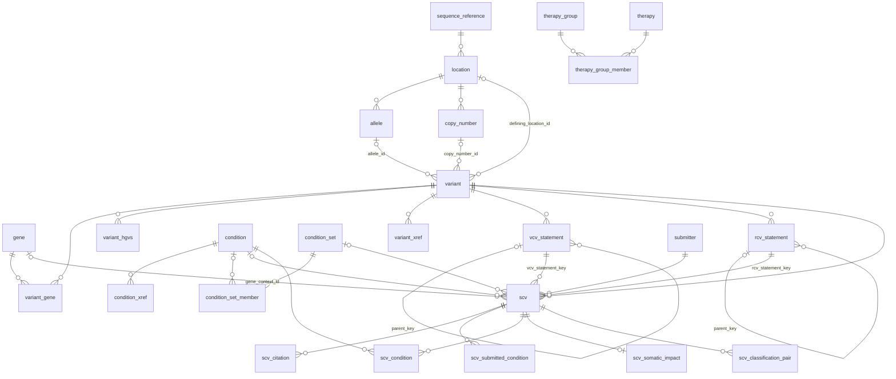

# ClinVar GKM browser: derived database schema

Status: draft, 25 October 2026. The schema of the tables the app queries, how one ClinVar-GKM parquet release is loaded into them, and how they're stored.

**Decided 25 October 2026:**
- **The derived tables are stored as parquet,** one sorted ZSTD file per table, which the server queries with DuckDB through a view per table ([storage eval](research/storage-format-eval.md)).
- **References are declared and checked, not enforced** ([Faithful to upstream](#faithful-to-upstream)). The SQL is in `packages/derive/sql/`:
- `schema.sql`: the DDL, with primary keys, foreign keys, checks and seeded vocabularies.
- `load.sql`: the load from parquet.
- `validate.sql`: checks run after a load, before a release is switched in.
- `../reference-checks.awk`: generates one check per declared reference from `schema.sql`; see [Faithful to upstream](#faithful-to-upstream).

The source tables are described in [source-schema.md](source-schema.md). Why the app reshapes them is in [data.md](data.md#derived-model).

**Schema version 1.** Loaded from ClinVar-GKM 1.1.0, ClinVar release 2026-10-18 (results below).

## Running it

```sh
scripts/fetch-source.sh              # download and verify the parquet set into data/source/<release>/
scripts/derive.sh [release]          # build data/derived/1/<release>/<table>.parquet
DERIVE_PROFILE=1 scripts/derive.sh   # also print DuckDB memory use by category after every statement
scripts/sql.sh [release]             # DuckDB shell with a view per derived table
```

`derive.sh` uses the DuckDB CLI, with DuckDB's memory limited to 4 GB (`DUCKDB_MEMORY_LIMIT`) to match the podman machine. The steps:
1. Strip the `REFERENCES` clauses from `schema.sql`, keeping primary keys, so duplicate IDs still fail the load.
2. Load into a scratch DuckDB database in `data/tmp/`.
3. Run the generated reference checks and `validate.sql`, which fails the build on any problem.
4. `EXPORT DATABASE` every table as parquet: ZSTD, 100k-row groups, in its sorted order.
5. Write `manifest.json` with the release metadata and row counts.
6. Replace `data/derived/1/<release>/` in one step, only if everything succeeded.

From M1 the server runs the same SQL through `@duckdb/node-api`.

A release directory holds `<table>.parquet` for every table, `manifest.json`, and the `schema.sql` and `load.sql` that `EXPORT DATABASE` writes. Those two recreate a DuckDB database from the files (`IMPORT DATABASE`), for anyone who wants one.

## Design

- **Upstream's numeric IDs become integers,** named after the entity: `variation_id` 10 for `clinvar:10`, `scv_id` 20176 for `SCV000020176`, `condition_id`, `submitter_id`, `gene_id`. GA4GH digest IDs (VRS alleles, locations, refget sequences) and therapy hashes stay as published, since they're the identifiers people use.
- **Surrogate keys** (`_key`) only where upstream has no usable single ID: condition sets (two ID formats) and aggregate statements.
- **Propositions are folded into their statements.** Upstream's propositions are 1:1 with statements, so the variant, condition, predicate, gene context, inheritance and penetrance become columns of `scv`, `vcv_statement` and `rcv_statement`. The three somatic proposition types that only evidence lines target (diagnostic, prognostic, therapeutic response) go in `scv_somatic_impact`.
- **Nested fields become columns or child tables:**
  - extension entries such as review status and submission level become typed columns;
  - lists become child tables: genes, HGVS expressions, cross-references, citations, submitted conditions;
  - short value lists with no table to reference stay as lists: collection methods, submitted gene symbols, molecular consequences.
- **Every relationship is declared** with a `REFERENCES` clause in `schema.sql`, which documents the model and drives the generated reference checks. The build strips the clauses, so nothing is enforced at load time ([Faithful to upstream](#faithful-to-upstream)). A relationship upstream's data is known to break is declared in a comment instead, `-- REFERENCES … NOT ENFORCED: <reason>`. Tables are still loaded parents first.
- **Vocabularies are lookup tables, not ENUMs:** classification types, submission levels, and review statuses with their star ratings. They carry labels and ordering, and a value upstream adds fails the load at its foreign key instead of loading silently. That's what we want for an unattended weekly update: the previous release keeps serving, and the new value is added in a schema version bump.
- **Physical order.** Rows are inserted sorted by their main lookup key: `scv` and the child tables by `variation_id`, locations by sequence and position. DuckDB's per-block min/max statistics then skip most of a table for a lookup, without an index.
- **Upstream's `data` JSON isn't copied** ([source-schema.md](source-schema.md#what-to-do-with-data)).

## Faithful to upstream

Decided 25 October 2026: **the derived database represents ClinVar and ClinVar-GKM as published, including where they're wrong.** The load never invents, drops or repairs rows to satisfy a constraint.

- **A relationship the data breaks isn't enforced.** In 2026-10-18 there's one: 31 SCV propositions name 3 NCBI genes (GLRA4, CCDC144NL, RNU6-81P) that upstream's `gene` table lacks. `scv.gene_context_id` keeps those IDs, and its reference to `gene` is declared `NOT ENFORCED`. Queries that join to `gene` should LEFT JOIN.
- **Every declared relationship is checked after each load.** `reference-checks.awk` turns each `REFERENCES` clause (and each `NOT ENFORCED` comment) in `schema.sql` into an anti-join. Dangling values go in the `reference_issue` table: child table and column, parent table and column, missing value, rows affected. The 53 checks take 1.6 s.
- **`reference_issue` is data,** not a log. The SQL console can query it, and the app can show it (e.g. a data-quality page, or a note on an affected SCV). Issues there are worth reporting upstream.
- **A relationship that breaks in a future release loads anyway,** and appears in `reference_issue`.
- **Lookups that translate IDs hide breakage.** Where the load maps an upstream ID through a lookup join (a condition set ID to `condition_set_key`, a parent statement ID to `parent_key`), a missing target gives NULL rather than a dangling value, so the reference checks can't see it. `CHECK` constraints and `validate.sql` cover these: an SCV must have exactly one of `condition_id` and `condition_set_key`, and a non-root statement must have a parent.

## Tables



The vocabulary tables (`classification_type`, `submission_level`, `review_status`) and the release metadata (`release`, `source_file`) are left out of the diagram.

| Table | Key | One row per | From (upstream) |
| --- | --- | --- | --- |
| `release`, `source_file` | | the release; each parquet file | `manifest.json` |
| `reference_issue` | | dangling value of a declared reference | generated checks, after the load |
| `classification_type`, `submission_level`, `review_status` | code / status | vocabulary entry | seeded in `schema.sql` |
| `sequence_reference` | `sequence_reference_id` | RefSeq sequence | `sequenceReference` |
| `location` | `location_id` | VRS sequence location | `location` |
| `allele` | `allele_id` | VRS allele, with SPDI and a VCF-style key from `data` | `allele` |
| `copy_number` | `copy_number_id` | VRS copy-number count or change | `copyNumberCount`, `copyNumberChange` |
| `gene` | `gene_id` | NCBI gene | `gene` |
| `variant` | `variation_id` | ClinVar variation, with its one VRS member | `variation` (+ VCV version from `vcv` IDs) |
| `variant_gene` | (`variation_id`, `gene_id`) | entry in the variant's gene list | `variation.extensions` `clinvarGeneList` |
| `variant_hgvs` | | entry in the variant's HGVS list | `variation.extensions` `clinvarHgvsList` |
| `variant_xref` | | identifier in another system | `variation.mappings` |
| `condition` | `condition_id` | ClinVar trait | `condition` |
| `condition_xref` | | MONDO, OMIM, Orphanet, HPO… mapping | `condition.mappings` |
| `condition_set` | `condition_set_key` | TraitSet or minted set | `conditionSet` |
| `condition_set_member` | | direct member (a condition, or a nested TraitSet) | `conditionSet.concepts` |
| `therapy`, `therapy_group`, `therapy_group_member` | | therapy; combination; member | `therapy`, `therapyGroup` |
| `submitter` | `submitter_id` | organization | `submitter` |
| `vcv_statement` | `vcv_statement_key` | VCV statement node: root, level or tier | `vcv` + its proposition + `vcv_evidenceLine` |
| `rcv_statement` | `rcv_statement_key` | RCV statement node | `rcv` + its proposition + `rcv_evidenceLine` |
| `scv` | `scv_id` | submission | `scv` + its proposition + the VCV/RCV statements citing it |
| `scv_citation` | | citation | `scv.reportedIn` |
| `scv_submitted_condition` | | condition as submitted, with its match | `scv.extensions` `submittedCondition(Set)` |
| `scv_condition` | (`scv_id`, `condition_id`) | condition the SCV is about, sets expanded | the proposition's object |
| `scv_somatic_impact` | `scv_id` | somatic clinical impact detail and tier | `evidenceLine` + its target proposition |
| `scv_classification_pair` | (`a_scv_id`, `b_scv_id`), checked not indexed | every ordered pair of SCVs conflict detection compares, with its level and condition flags ([data.md](data.md#conflicts)) | derived from `scv` |

### Aggregate statement trees

A VCV or RCV accession is a tree: one root per classification type, citing one node per submission level, each citing its SCVs. Somatic clinical impact adds a tier node between level and SCVs. Upstream encodes this in statement IDs and evidence lines; here it's `node_kind`, `parent_key` and `contributes`:

```
VCV000000010.141-G-PATH            root    classification 'Pathogenic'
├── VCV000000010.141-G-PATH-CP     level   contributes = true    ← 45 scv rows have this vcv_statement_key
├── VCV000000010.141-G-PATH-NOCP   level   contributes = false   ← 8 scv rows
└── VCV000000010.141-G-PATH-FLAG   level   contributes = false   ← 2 scv rows
VCV…-S-SCI                         root    (somatic clinical impact, illustrative)
└── VCV…-S-SCI-CP                  level
    └── VCV…-S-SCI-CP-T1           tier                          ← scv rows
```

Every SCV is cited by exactly one VCV node and one RCV node (checked against the 2026-10-18 data). Those become `scv.vcv_statement_key` and `scv.rcv_statement_key`, both NOT NULL. The node's variant, classification type and level always match the SCV's (also checked), and `validate.sql` re-checks this every load.

## How the load works

`load.sql` runs as one script against the scratch database, with a second scratch database attached as `stage` for intermediate tables. The order:

1. **Stage the propositions** (`stage.prop`, 28M rows): every proposition table read once, with the variant ID parsed to an integer.
2. **Release metadata** from `manifest.json`.
3. **Genome:** `sequence_reference`, `location`, `allele` (SPDI, VCF key and state parsed from `data`), `copy_number`.
4. **Genes and variants:** `gene`, `variant`, then its gene list, HGVS list and cross-references from a staged copy of `variation`'s nested columns.
5. **Conditions and therapies:** `condition`, `condition_xref`, `condition_set`, `condition_set_member`, a staged condition-set expansion (nested TraitSets resolved), therapies, `submitter`.
6. **Aggregate statements:** evidence-line edges staged; VCV and RCV statements staged together, joined to their propositions and parents; then each tree inserted in three passes (roots, levels, tiers), because a self-referencing foreign key needs the parent row inserted by an earlier statement.
7. **SCVs:**
   - `scv.parquet` is flattened to scalar columns in one streaming pass;
   - the SCV propositions are filtered out of `stage.prop`;
   - the two are joined, with the citing statements and condition sets, sorted by variant, and inserted.
8. **SCV children:** citations, submitted conditions, the expanded `scv_condition`, and `scv_somatic_impact`.
9. **Classification pairs:** `scv_classification_pair`, a self-join of `scv` within each variant and conflict-detectable type, both orders, sorted by side A's submitter then variant. `validate.sql` checks that the count is n×(n−1) per group, that each pair's reverse exists with the same level, and that no pair repeats.
10. **Reference checks** (generated from `schema.sql`) fill `reference_issue`.
11. **`validate.sql`,** then **export** to parquet. The scratch databases are deleted.

## Load performance: what we learned

The load has to fit the 4 GiB podman machine. Getting there took four failed or slow runs; `DERIVE_PROFILE=1` and `EXPLAIN ANALYZE` showed why.

- **Wide nested values through a join and sort ran out of memory.** The first `scv` insert joined raw `scv` rows to the 28M propositions and sorted the result. The raw rows carry nested `extensions` (every submitted condition's match details) and citation structs. It failed at the 4 GB limit even with spilling, on a small allocation DuckDB couldn't spill. Flattening `scv.parquet` to scalar columns first, then joining narrow tables, fits.
- **Most memory between statements was evictable.** Measured after each statement: cached table blocks peaked around 1.7 GB, which DuckDB evicts as needed, and indexes held about 300 MB. Neither caused the failure.
- **Staging tables go in an attached file.** They're ordinary tables in `stage.duckdb`, not `CREATE TEMP TABLE` (DuckDB's in-memory temp catalog). They can be evicted to disk, and dropping them leaves no dead space in the main database (DuckDB reuses freed blocks but doesn't shrink files).
- **An `AND` in a join's `ON` clause can turn a hash join into a nested loop.** `LEFT JOIN condition_set ON object_type = 'conditionSet' AND condition_set_id = object_id` compared 6.85M rows with 100k sets: 10 minutes of one statement. Writing it as `ON condition_set_id = CASE WHEN object_type = 'conditionSet' THEN object_id END` keeps it a hash join: 52 s with foreign keys, 12 s without. Upstream's `joining.md` warns about the same thing.
- **Every foreign key builds an index.** DuckDB builds an ART index on the referencing columns, not just for primary keys (`scv` has 11). That roughly doubles the file and slows inserts. See [Results](#results).
- **Indexes on strings are the costly ones.** A `UNIQUE` on the 21M statement ID strings was dropped; `validate.sql` checks their uniqueness instead.
- **The process exceeds DuckDB's own limit.** Resident memory peaked at 6.9–7.4 GB with `memory_limit` at 4 GB, measured on macOS. Some memory falls outside DuckDB's budget, or isn't returned to the system promptly. This has to be checked inside a 4 GiB container before we rely on it.

## Results

ClinVar release 2026-10-18, on the development Mac (Apple Silicon, 7 threads, DuckDB 1.5.5 CLI, `memory_limit` 4 GB). Built from the 13.2 GB parquet set already downloaded.

| | |
| --- | --- |
| Build time, download excluded | 2.5 min (load 2.1, checks and validation a few seconds, export 18 s) |
| Output | 1.9 GB of parquet (29 tables) |
| Peak resident memory | about 7.9 GB, against the 4 GB `memory_limit` |
| Reference checks | 53 relationships, 1.6 s; one issue (below) |
| `validate.sql` | passes |

- **Row counts:** `variant_hgvs` 43.4M, `scv_classification_pair` 15.3M, `rcv_statement` 12.1M, `variant_xref` 10.6M, `vcv_statement` 9.2M, `variant_gene` 7.4M, `scv_submitted_condition` 7.3M, `scv_condition` 7.3M, `scv` 6.85M, `variant` 4.69M, `allele` 4.60M, `location` 4.22M, `scv_citation` 1.64M.
- **One integrity gap upstream.** 31 SCV propositions name 3 NCBI genes (GLRA4, CCDC144NL, RNU6-81P) missing from upstream's `gene` table. Kept as published and listed in `reference_issue` ([Faithful to upstream](#faithful-to-upstream)). Every other reference resolves. Worth reporting to ClinVar-GKM.
- **Query times** against these files, for page-style and heavy "miner" queries: 10–300 ms, except free-text comment search at about 1.2 s ([storage eval](research/storage-format-eval.md)).

**Earlier alternatives, measured on the same data:**

| | Build | Size |
| --- | --- | --- |
| DuckDB file, foreign keys enforced | 6.7 min | 10.3 GB |
| DuckDB file, primary keys only | 2.4 min | 5.5 GB |
| Parquet (chosen) | 2.5 min | 1.9 GB |

- **Enforced foreign keys cost 4.8 GB of indexes and about 4.3 minutes, and bought no query speed.** DuckDB builds an index for every foreign key. A variant's SCVs came back in 1–3 ms either way, because rows are sorted by variant. Counting one submitter's SCVs took 210–280 ms with the index and 4–9 ms without.
- **The DuckDB file queried about 2× faster than parquet,** still within tens of milliseconds for pages, at 3× the size. Parquet also keeps the data readable outside DuckDB and independent of DuckDB's storage version.

## Open questions

1. **`variant_hgvs` is the largest table** (43M expressions). Keep all of them, or only those needed for display and search: MANE, genomic top-level and protein?
2. **Lookup tables vs ENUMs** for the vocabularies: lookup tables were chosen for labels and foreign keys. Revisit if join cost shows up in query benchmarks.
3. **Page-serving tables** (crosstabs, search terms, conflict pairs) come next, as a second layer over these tables, sized by M0's query benchmarks.
