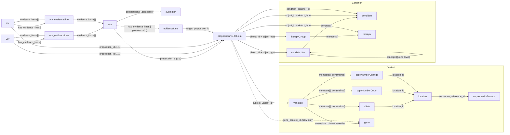

# ClinVar GKM browser: the source schema

Status: draft, 24 October 2026. A working summary of ClinVar-GKM's parquet release 1.1 (the 2026-10-18 ClinVar release): its tables, keys and foreign-key relations, the `data` column, and the joins that go wrong. It's what the derivation in [data.md](data.md#derived-model) reads. The full column reference is upstream, in clingen-data-model/clinvar-gkm: `docs/parquet/tables.md` and `docs/parquet/joining.md`. The raw `DESCRIBE` output is in [research/clinvar-gkm-parquet-describe.txt](research/clinvar-gkm-parquet-describe.txt).

## Shape

**22 tables, one parquet file each,** one per section of ClinVar-GKM's JSON bundle. Each row is one GA4GH object: a Cat-VRS categorical variant, a VRS allele, a VA-Spec proposition or statement, and so on.

Upstream groups them into six areas. Variants and conditions are the nouns; propositions say what is claimed about them; statements say who claimed it and how confidently.

| Area | Tables (rows) |
| --- | --- |
| **Variant** | `variation` (4.69M), `allele` (4.60M), `location` (4.22M), `copyNumberCount` (47k), `copyNumberChange` (32k), `sequenceReference` (214), `gene` (93k) |
| **Condition and therapy** | `condition` (23k), `conditionSet` (101k), `therapy` (38), `therapyGroup` (10) |
| **Proposition** | `propositionPathogenicity` (27.9M), `propositionClinvarCustom` (186k), `propositionOncogenicity` (9.6k), `propositionSomaticClinicalImpact` (12.6k) |
| **SCV** (submissions) | `scv` (6.85M), `evidenceLine` (1.6k; somatic clinical impact only), `submitter` (3,565) |
| **RCV** (aggregate per variant and condition) | `rcv` (12.1M), `rcv_evidenceLine` (12.2M) |
| **VCV** (aggregate per variant) | `vcv` (9.17M), `vcv_evidenceLine` (9.38M) |

The four proposition tables share one column schema, so `read_parquet('proposition*.parquet')` reads them as one table.

## Columns: typed columns plus `data`

Every table has an `id` and a `type`, then a set of **typed columns**: flat or nested (STRUCT, LIST) DuckDB types for the fields people query. For example, `scv.classification.name`, `scv.contributions[]` (`contributor`, `date`, `activityType`), `proposition*.subject_variant_id`, `location.loc_start`.

Nested fields follow GA4GH's extension pattern: `extensions` is a list of `{name, value_…}` structs. Fields like SCV review status are an entry in that list (`clinvarScvReviewStatus`), not a column of their own. That's what makes them awkward to filter on directly.

**The `data` column.** Almost every table also has `data`: the row's **complete GA4GH object as a JSON string**, exactly as in the JSON bundle. The typed columns are a subset of it. Two differences:
- **References inside `data` are bundle pointers** (`"#/submitter/clinvar.submitter:506395"`, `"#/propositionPathogenicity/SCV001800608-PATH"`). Typed columns carry the bare ID (`clinvar.submitter:506395`).
- **`data` is the bulk of the file:** 60–70% of each big file (`variation` 2.3 of 3.9 GB, `scv` about 2.1 of 3.2 GB, `propositionPathogenicity` 1.0 of 1.5 GB).

The exceptions: `therapy` and `therapyGroup` call the ID `key` and the JSON `value`; `condition` uses camelCase column names and gained `data` only in 1.1.0.

A sample, checked 24 October 2026: SCV001800608.1's `data` (1.8 KB) has the classification, contributions (submitted, created, evaluated, each with a submitter pointer), direction, extensions (SCV ID and version, submitted condition with MedGen match details, review status, local key, submission level), the proposition pointer, quality and strength. Every one of those is also in the typed columns.

## Identifiers

An ID's shape names its table. Several columns hold IDs of more than one kind, and the prefix (or a type column) says which table to join.

| ID shape | Example | Table |
| --- | --- | --- |
| `clinvar:<n>` | `clinvar:10` | `variation` |
| `ga4gh:VA.<digest>`, `ga4gh:CN.…`, `ga4gh:CX.…` | `ga4gh:VA.Apas_jvq…` | `allele`, `copyNumberCount`, `copyNumberChange` |
| `ga4gh:SL.<digest>` | | `location` |
| `SQ.<digest>` | | `sequenceReference` |
| `ncbigene:<n>` | `ncbigene:675` | `gene` |
| `clinvar.trait:<n>` | `clinvar.trait:9580` | `condition` |
| `clinvar.traitset:<n>`, `clinvar.conditionset:vcv-<md5>` | | `conditionSet` (ClinVar's own, or minted for a VCV aggregate) |
| `clinvar.therapy:<sha256>`, `clinvar.therapygroup:<sha256>` | | `therapy`, `therapyGroup` |
| `clinvar.submitter:<n>` | `clinvar.submitter:500034` | `submitter` |
| `clinvar.submission:SCV<n>.<ver>` | `clinvar.submission:SCV000056982.2` | `scv` (and `evidenceLine`, which shares the key) |
| `SCV<n>-<CODE>` | `SCV000056982-ASSOC` | a proposition table (a submission's proposition) |
| `VCV<n>-<lane>-<CODE>[-<LEVEL>]` | `VCV000051592-G-PATH-CP` | a proposition table (an aggregate's proposition) |
| `VCV<n>.<ver>-<lane>-<CODE>[-<LEVEL>]`, `RCV…` | `VCV000051592.122-G-PATH-CP` | `vcv`, `rcv` |
| `<statement id>.contributing` / `.non-contributing` | | `vcv_evidenceLine`, `rcv_evidenceLine` |

Useful facts:
- **A proposition's ID is its statement's ID without the version.**
- **The code names the proposition table:** `PATH` is in `propositionPathogenicity`; `ONCO` in `propositionOncogenicity`; `SCI`, `DIAG`, `PROG`, `TR` in `propositionSomaticClinicalImpact`; everything else (`NP`, `DR`, `RF`, `OTH`, `ASSOC`, `AFF`, `CDFS`, `PROTECT`, `CS`) in `propositionClinvarCustom`.
- **Lane** is `G` (germline) or `S` (somatic). **Level** is the aggregate tier: `PG` (practice guideline), `EP` (expert panel), `CP` (criteria provided), `NOCP` (no criteria), `NOCL` (no classification), `FLAG` (flagged).
- **A VCV accession number is the variation ID:** `VCV000000010` is `clinvar:10`, without exception.

## Foreign keys

Upstream calls the main joins **seams**:

| Seam | From → to | Cardinality and notes |
| --- | --- | --- |
| **A** | `proposition*.subject_variant_id` → `variation.id` | Many propositions per variant (`clinvar:10` has 101). All 28.1M references resolve |
| **B** | `proposition*.object_id` → `condition` / `conditionSet` / `therapy` / `therapyGroup`, chosen by `object_type` | 25.1M to a condition, 2.96M to a set, 13 to therapies. A set's `concepts` can include a ClinVar trait set, one level deep. `AND` sets mean together, `OR` sets mean any |
| **C** | `scv` / `vcv` / `rcv`.`proposition_id` → `proposition*.id` | Exactly 1:1. Treat the proposition as a side table of its statement |
| **D** | VCV or RCV root statement → level statements → SCVs, through `has_evidence_lines` then `evidence_items` | A VCV accession is a small tree: one root per lane and code, citing one statement per level, each citing its SCVs, each marked contributing or non-contributing |
| **E** | SCV → its aggregate | Every SCV is cited by exactly one VCV level statement (6,853,781 pairs) |
| Submitter | `scv.contributions[]` where `activityType = 'submitted'` → `submitter.id` | One submitter per SCV. Dates are in the same array: `submitted`, `created`, `evaluated` (may be null) |
| Variant detail | `variation.members[]` → `allele` / copy-number tables by prefix; then `location`, then `sequenceReference` | GRCh38 VRS objects. Some variants have no VRS members (e.g. a cytogenetic inversion: `vrsPreProcessingIssue`) |

## Joins that lie

From upstream's `joining.md`, each returns plausible numbers with no error:

- **Reading only `propositionPathogenicity`** for "what's claimed about this variant" misses risk-factor, drug-response, not-provided and other claims (79 of `clinvar:10`'s 101 propositions). Read `proposition*` unless you mean pathogenicity only.
- **An inner join of `object_id` to `condition` alone** drops the 2.95M propositions (10.6%) whose object is a condition set. Join each branch, and use LEFT JOIN so missing rows show up.
- **`gene_context_id` is not the variant's genes.** It's the gene a submitter named, and it's set only on SCV propositions. The variant's genes are in `variation.extensions` (`clinvarGeneList`).
- **Releases before 1.1.0** stored bundle pointers, not bare IDs, in some typed columns. We read 1.1 only.

## What the derivation does with this

[data.md](data.md#derived-model) has the target tables. In terms of the seams above:
- `scv` gets `variation_id` (seams C and A), `submitter_id` and its dates (the contributions array), and its aggregate level (seam E), as plain columns.
- `scv_condition` resolves seam B, including set expansion, to one row per SCV per condition.
- `variant` gets its genes, MANE HGVS and molecular consequence from `variation.extensions`, coordinates from the allele → location → sequenceReference chain, and its aggregate calls from the VCV root statements.

## What to do with `data`

The derived tables don't need `data`: every field they use is in the typed columns. `data` matters only for showing or exporting a record as GA4GH JSON, and there's a catch: a standalone record isn't one row. An SCV's full VA-Spec statement embeds or references its proposition, variant, condition and submitter, so producing it means collecting the `data` of several rows and resolving the `#/…` pointers. Upstream's `src/scripts/sub-bundle.py` does this for a list of IDs.

Options, to measure in M0:

| Option | Disk | Detail-view cost | Notes |
| --- | --- | --- | --- |
| **Read `data` from `source/` on demand** | None extra | One lookup per referenced object. The files are unsorted, so each lookup scans the `id` column (tens of MB locally) and then reads one row group of `data` | Possibly fine on a local SSD. Measure first |
| **Copy `data` into a keyed `record_json` table,** for the tables detail views need (`scv`, `variation`, `proposition*`, `condition`, `submitter`, the VCV/RCV statements) | Several GB (most of the 13.2 GB source is `data`) | One indexed lookup per object | Simplest code. Doubles disk use for those tables |
| **Rewrite `source/` sorted by `id`** at download time, with smaller row groups | None extra if it replaces the downloaded files | Row-group statistics jump straight to the right block | The SQL console's raw views get the same speed-up. Costs a 13 GB sort per release. We'd keep the upstream checksums to detect updates, since the files on disk would no longer match them |
| **Regenerate JSON from the typed columns** | None | Cheap | Re-implements upstream's serialization and could drift from it. Not recommended |

**Leaning:** measure on-demand reads first. If too slow, rewrite `source/` sorted, which helps the SQL console as well. Copy into `record_json` only if disk is no concern.
